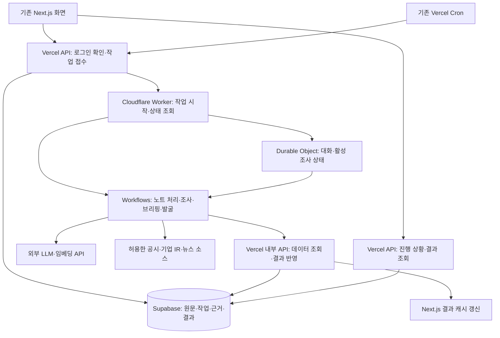

# StockLab 개인 리서치 에이전트 기획서

작성일: 2026-10-23 · 상태: 구현 전 제안

## 1. 목표와 방향

투자 노트가 쌓일수록 내 원칙을 더 정확하게 반영하고, 과거 판단과 새로운 근거를 연결해 질문·브리핑·종목 발굴에 활용한다. Vercel의 기존 Next.js 화면과 Supabase를 유지하고, Cloudflare Workers에 리서치 실행 기능을 추가한다.

사용자가 체감할 변화:

- 질문: “내가 이 종목을 꺼렸던 이유가 지금도 유효해?”에 과거 노트와 새 근거를 인용해 답한다.
- 브리핑: 뉴스 요약과 함께 “어제 확인하기로 한 조건이 어떻게 바뀌었는가”를 설명한다.
- 발굴: 정량 룰 통과 외에 “왜 내 원칙에 맞는가, 왜 지금 재검토해야 하는가, 어떤 근거가 부족한가”를 제시한다.

초기 가정은 개인용·한국/미국 주식·기존 데이터 제공업체 유지다. Cloudflare 자체가 모델의 추론 능력을 높이는 것은 아니며, 관련 기억 검색·추가 조사·검증을 실행하는 기반으로 사용한다. 제공업체·모델·계정별 지원과 비용은 구현 시 다시 확인한다.

## 2. 현재 기능과 개선 지점

| 기능 | 현재 동작 | 개선할 부분 |
|---|---|---|
| 투자 노트 | Supabase 저장, 관련 종목·최신순 선별, 일부 기능에서 앞부분만 전달 | 의미 기반 검색, 적용 조건·예외·원칙 변경 이력 |
| Watchlist 질문 | 단순 질의는 코드 계산, 복잡한 질의는 키워드로 자료를 골라 LLM 1회 호출 | 이전 대화와 판단 참조, 필요한 근거 추가 조사 |
| 종목 분석 | 시세·재무·룰·뉴스 제목·노트를 모아 1회 분석 | 출처가 있는 조사 기록과 반대 근거 활용 |
| 브리핑 | 관심종목 데이터와 최근 분석·일부 노트로 생성, 직전 시각으로 새 뉴스 표시 | 직전 결론·미해결 질문과 실제 비교, 근거 검증 |
| 발굴 | 캐시된 재무지표 룰 검사 → 통과 개수 상위 10개 → 최신 노트 8개 일부로 최대 5개 제안 | 다양한 후보 생성, 후보별 조사, 제외 사유와 재검토 조건 기록 |
| 예약 실행 | Vercel Cron에서 브리핑 후 발굴을 순차 실행 | 독립 작업으로 분리, 단계별 재개·상태 표시 |

현재 OpenAI 브리핑의 기본 추론 설정은 `low`, 해당 추론 모델의 생성 예산은 최소 12,000토큰이다. 이 값을 출발점으로 삼되, 품질·지연·토큰 사용량을 비교한 뒤 기능별로 결정한다. 상위 모델·높은 추론량을 모든 단계에 일괄 적용하지 않는다.

## 3. 전체 구성과 책임

| 구성 | 책임 |
|---|---|
| Vercel / Next.js | 화면·기존 인증·작업 접수·기존 데이터 제공업체 호출·DB 반영·캐시 갱신 |
| Supabase | 노트 원문/버전, 승인된 원칙, 검색 인덱스, 조사 근거, 작업 이력, 최종 결과의 기준 저장소 |
| Worker | Vercel 요청 인증, Workflow 시작·조회, 대화 요청 라우팅 |
| Workflows | 자료 수집·검색·LLM 호출·검증·결과 반영의 단계별 실행과 제한된 재시도 |
| Durable Objects | 대화 세션별 메시지·활성 조사 참조·후속 질문 상태. 긴 조사 작업은 Workflow에 위임 |
| 외부 LLM | 노트 구조화·검색 질의 생성·근거 해석·보고서 작성 |

첫 연결은 Worker가 Vercel의 제한된 내부 API를 호출하는 방식으로 한다. `next/cache`가 포함된 기존 DB 코드를 Worker에 그대로 가져오지 않는다. KIS 토큰과 호출 제한도 우선 기존 제공업체 코드에서 관리한다. Worker의 DB 직접 연결은 병목이 측정됐을 때 별도 검토한다.

DO에는 전체 노트 DB를 복제하지 않는다. 대화 상태는 DO, Workflow 실행 단계는 Workflows, 최종 결과와 원칙·근거는 Supabase에 둔다. 사용자 식별자는 클라이언트 입력을 신뢰하지 않고 서버에서 정한다. 초기에는 기존 개인용 인증에 고정된 소유자 식별자를 연결하며 멀티유저 인증 전환은 별도 범위다.

## 4. 투자 노트를 지식과 판단 기준으로 활용

### 노트 저장 이후 처리

1. 기존 저장을 완료하고 노트 ID·버전으로 처리 작업을 접수한다.
2. 내용을 문맥 단위로 나누고 임베딩과 원문 위치를 저장한다. 최초 도입 시 기존 노트도 일괄 처리한다.
3. LLM이 원칙·가설·과거 판단·예외·미해결 질문을 구분해 후보를 추출한다.
4. 원칙 후보를 원문 인용과 함께 사용자에게 보여준다. 확인한 항목만 공식 판단 기준으로 사용한다.
5. 노트 수정·삭제 시 기존 검색 조각을 무효화한다. 삭제된 원문은 새 분석에서 검색·인용하지 않고, 과거 결과는 원문 삭제 여부를 표시한다.

예: “저PER를 선호하지만 경기민감주는 이익 정점일 수 있어 제외한다”에서 선호 조건과 예외를 함께 보관한다. 새 노트가 기존 원칙과 충돌하면 자동으로 덮어쓰지 않고 변경 후보로 제시한다.

### 질문·분석 시 검색

- 종목/산업/키워드 필터와 의미 유사도 검색을 결합한다. 의미 유사도는 진위나 투자 적합도 점수가 아니다.
- Supabase `pgvector`를 검색 저장소로 사용해 원문과 인덱스를 한곳에서 관리한다. 임베딩 모델·벡터 차원은 구현 단계에서 고정하고 변경 시 재색인한다.
- 검색 결과에는 원문 ID·버전·작성 시점·해당 구절을 포함한다. 관련 원칙과 그 예외를 함께 전달한다.
- 승인된 원칙을 우선하되, 사실과 충돌하면 충돌을 명시한다. 개인 노트의 가설을 검증된 사실로 표현하지 않는다.

초기 “학습”은 검색·기억과 사용자 피드백으로 구현한다. 모델 가중치를 바꾸는 파인튜닝은 좋은 질문/답변·수정 사례를 모은 뒤 별도 실험한다. AI가 쓴 분석을 검토 없이 다음 학습의 정답으로 쓰지 않는다.

## 5. 브리핑 고도화

아침은 간밤 미국 장과 오늘 한국 장, 저녁은 한국 장 마감과 미국 장의 확인 과제를 유지한다. 현재 Watchlist 중심 범위에서 시작한다.

### 생성 단계

1. **시점 고정:** 대상 시장·한국 날짜·슬롯·데이터 기준 시각과 사용한 노트 버전을 기록한다.
2. **기존 판단 조회:** 직전 브리핑 본문, 종목 분석, 발굴 조사, 확인 대기 항목을 읽는다.
3. **자료 갱신:** 시세·재무·뉴스·가능한 공시/IR 근거를 수집하고 캐시 시각을 확인한다.
4. **변화 비교:** 이전 스냅샷과 수치를 코드로 비교한다. 첫 실행은 기준선 생성으로 표시한다.
5. **관련 원칙 검색:** 변화의 의미를 판단하는 데 필요한 노트·예외를 가져온다.
6. **초안 작성:** 확인된 사실·해석·기존 판단 영향·다음 확인을 작성한다.
7. **검증과 저장:** 근거 연결·수치·시각·원칙 적용을 검사하고 기존 화면용 결과와 상세 근거를 저장한다.

초기 검증은 코드로 수치·ID·출처 연결을 검사하고, 문제 구간만 제한된 LLM 재검토를 한다. 검증용 모델의 동의만으로 사실 확인이 끝났다고 간주하지 않는다. 근거가 부족하면 “판단 보류/확인 필요”로 남긴다.

### 화면에 보여줄 결과

- 핵심 변화와 직전 판단의 유지/강화/약화/재검토 필요 여부
- 적용한 투자 원칙·예외와 원문 링크
- 근거의 출처·발표일·조회 시각, 자료가 오래됐거나 누락된 경우 표시
- 지난 브리핑의 확인 과제에 대한 결과와 새 확인 과제

출력 예: “지난 브리핑에서 우려한 부채 부담이 이번 공시 수치에서 줄었다. 다만 영업현금흐름은 아직 확인되지 않아 기존 관망 판단을 유지한다.” 실제 수치와 판단은 확보한 근거로만 작성한다.

## 6. 발굴 고도화

발굴의 목표는 주가 예측이 아니라 내 원칙에 맞는 조사 대상을 찾고 재검토할 이유를 설명하는 것이다.

### 후보 생성 경로

| 경로 | 방식 | 도입 시점 |
|---|---|---|
| 정량 룰 | 기존 재무 스크리닝을 유지하고 산업·데이터 최신성 등을 함께 고려 | 첫 발굴 개선 |
| 과거 후보 재검토 | 제외 사유·확인 대기 조건에 변화가 생긴 종목을 다시 조사 | 첫 발굴 개선 |
| 이벤트 기반 | 실적·공시 등 검증 가능한 변화에서 후보 생성 | 소스 확보 후 확장 |
| 원칙/산업 기반 | 내 노트의 관심 산업과 맞는 기업을 종목 마스터에서 탐색 | 기업 설명 데이터 확보 후 확장 |

LLM이 제시한 티커는 종목 마스터로 확인한다. 정량 룰에서 제외된 기업을 다른 경로로 검토한다면 위반 조건을 명시하고, 필수 제외 조건을 몰래 완화하지 않는다. 데이터가 없는 종목을 “룰 불통과”로 처리하지 않고 자료 부족으로 구분한다.

### 후보 조사와 결과

1. 후보별 사업 설명·재무 추이·최근 공시/뉴스와 관련 노트를 모은다.
2. 적합 근거와 반대 근거를 함께 검토하고, 과거 조사와 달라진 점을 찾는다.
3. “심층 검토”, “조건 확인 대기”, “제외”로 구분해 사유와 재검토 조건을 저장한다.
4. 발굴에서 생성한 확인 과제를 다음 브리핑이 이어받는다. 조건 변화가 없으면 같은 기업을 새 발굴처럼 반복하지 않는다.

화면에는 왜 발견됐는지, 맞는 원칙, 반대 근거, 부족한 자료, 다음 확인 조건을 표시한다. 적합도와 근거 충분도를 분리하며 적합도 점수를 수익 확률처럼 표시하지 않는다.

초기 실험 범위 제안은 기존 캐시 유니버스 내 후보 최대 20개의 가벼운 평가 → 상위 최대 3개 심층 조사다. 이는 플랫폼 제한이 아닌 비용·품질 실험용 상한이며 실제 토큰·시간을 측정해 조정한다.

## 7. 질문 기능과 Durable Objects

단순 시세·룰 질의는 기존 로컬 계산 경로를 유지한다. 복잡한 질문은 관련 노트와 조사 기록을 검색해 답하고, 부족한 자료가 있으면 추가 조사 작업을 만들 수 있다.

대화 세션별 DO는 이전 메시지, 대화 요약, 마지막에 언급한 종목·근거 ID, 활성 작업 ID를 보관한다. 다음 질문에는 필요한 문맥만 전달하며 전체 대화를 무한히 붙이지 않는다. DO에 저장되는 상태도 모델의 가중치 학습과는 다르다.

일반 질문은 먼저 검색 기반으로 답하고, 심층 조사는 사용자가 선택할 수 있게 한다. 조사 중에는 현재 단계와 부분 결과를 보여주며 새로고침 후에도 작업을 이어서 확인한다. 초기 UI는 작업 상태 polling으로 시작하고 실시간 WebSocket 연결은 대화 기능을 도입할 때 추가한다.

## 8. 기존 앱과 연결하는 계약

구현 시 아래 경로는 예시이며, API 스키마와 인증 방식부터 확정한다.

| 연결 | 동작 |
|---|---|
| 기존 `/api/briefing`, `/api/discover` | 기능별 전환 설정에 따라 기존 실행 또는 신규 비동기 작업 접수. 신규 경로는 `202 + jobId` 반환 |
| 기존 브리핑 Cron | 기존 인증·슬롯을 유지하고 브리핑/발굴을 독립 작업으로 접수. 기존 스크리닝 갱신 Cron은 유지 |
| Vercel → Worker `/jobs` | 작업 종류·ID·소유자·중복 방지 키로 실행 접수 |
| Worker → Vercel 내부 API | 승인된 데이터 조회, 단계 상태 반영, 검증된 최종 결과 저장 |
| UI → Vercel `/api/research-jobs/:id` | 인증 후 상태·실패 사유·결과 링크 조회 |
| 노트 저장/수정 | 원문 저장 이후 버전별 색인 작업 접수. 실패 시 원문은 보존하고 재처리 가능 |

Vercel과 Worker 간 요청에는 별도 서비스 인증과 요청 시각·재전송 방지를 적용한다. 브라우저에는 서비스 시크릿을 보내지 않는다. 내부 API는 필요한 조회/반영만 제공하며 임의 SQL 실행 기능은 만들지 않는다.

최종 저장은 기존 `insertBriefing`·`insertDiscovery`를 확장한 Vercel 결과 반영 경로에서 처리한다. 작업 ID와 결과를 한 트랜잭션에서 확정하고, 응답 유실로 다시 호출돼도 기존 결과를 반환한다. 저장 후 기존 `revalidateTag`를 실행한다. 캐시 갱신만 실패한 경우 결과를 다시 생성하지 않고 캐시 갱신만 재시도한다.

Worker는 `queued → running → validating → completed / partial / failed` 상태를 Vercel에 반영한다. 사용자는 접수 성공과 생성 완료를 구분해서 본다. 오래 상태가 바뀌지 않는 작업은 Workflow 상태와 대조하는 복구 절차를 둔다.

## 9. 데이터 확장안

아래는 논리적 데이터 단위다. 실제 테이블 수와 기존 JSON 필드 활용은 구현 설계에서 최소화한다.

| 데이터 | 저장 내용 |
|---|---|
| 노트 버전/검색 조각 | 원문 버전·문단 위치·임베딩·현재 유효 여부 |
| 투자 원칙 | 조건·예외·출처 구절·승인/제안/철회 상태·이전 버전 연결 |
| 조사 작업 | 종류·슬롯·시점·중복 방지 키·진행 상태·사용 모델·예산·실패 단계 |
| 조사 근거 | 출처 URL·문서 식별자·발표일·조회 시각·확인한 구절·관련 종목 |
| 종목별 판단/확인 과제 | 기존 결론·근거·반대 근거·확인할 조건·결과·마지막 검토 시각 |
| 평가 피드백 | 유용/오류/원칙 적용 오류·사용자 수정·관련 결과/근거 ID |

기존 브리핑·발굴 테이블과 화면에 필요한 출력 형식은 우선 유지하고 작업·근거 ID를 연결한다. DB 변화는 추가 방식으로 적용하고, 기존 데이터를 삭제하거나 전면 이전하지 않는다.

## 10. 운영·비용·자료 취급

- **자료 소스:** 처음에는 기존 제공업체와 접근 가능한 공식 공시/IR을 사용한다. 뉴스 제목은 제목으로 표시하고 본문이 확보된 것처럼 설명하지 않는다. 본문 수집 가능성·이용 조건·API 비용은 소스별로 확인한다.
- **수집 도구:** 허용한 소스만 조회하고 문서 크기·호출 시간·추가 조사 횟수를 제한한다. 외부 문서의 지시문은 데이터로 취급하고 도구 실행 권한으로 해석하지 않는다.
- **예산:** 토큰·임베딩·외부 데이터·Cloudflare 실행 비용을 분리해 기록한다. 월 예산은 사용자와 정하고, 그 전에는 소수 작업의 비용부터 측정한다. 작업별 최대 호출 수·토큰 수·후보 수를 제한한다.
- **재시도:** 통신 오류·일시적 제한은 제한된 backoff 재시도, 인증·스키마·토큰 소진은 사유별 처리다. 같은 실패를 무한 재시도하지 않는다. LLM 호출은 재시도 시 중복 과금 가능성이 있어 DB 중복 저장 방지와 별도로 관리한다.
- **중복 실행:** 예약 작업 키는 소유자+종류+한국 날짜+슬롯으로 고정한다. 수동 재생성은 명시적 새 작업으로 구분한다. DO 상태만으로 중복 방지를 보장하지 않고 접수/저장 DB의 유일 제약도 적용한다.
- **실패 표시:** 브리핑과 발굴은 서로 독립시킨다. 일부 종목 조사만 실패하면 실패 범위를 명시한 부분 결과를 제공할 수 있지만, 필수 검증 실패는 완료로 표시하지 않는다.
- **동기화:** 노트 변경 이벤트가 접수에 실패한 경우 미처리 버전을 다시 찾는다. 삭제·철회된 원칙은 새 결과에서 사용하지 않는다.
- **개인 데이터:** 노트·대화·근거가 Cloudflare 및 선택한 모델 제공업체에 전달되는 범위를 설정 화면과 문서에 명시한다. 운영 데이터 최초 전송 전에 확인한다. 시크릿·인증 헤더·투자 노트 본문을 운영 로그에 남기지 않는다.
- **관측:** 작업 ID로 단계·오류·소요 시간·토큰을 추적한다. Sentry는 별도 보류 사항이며 이 기획의 구현 선행 조건으로 두지 않는다. AI Gateway는 모델 호출 관측이 필요할 때 선택적으로 추가한다.

## 11. 단계별 출시

| 단계 | 범위 | 완료 기준 |
|---|---|---|
| 0. 기준선·설계 확인 | 기존 질문/브리핑/발굴 샘플과 평가 질문 고정, 계정·예산·자료 소스·내부 API 인증 확인 | 현재 결과와 비용/시간 기록, 필요한 데이터 접근과 배포 권한 확인 |
| 1. Worker 연결 + 노트 지식화 | 비동기 작업 기반, 노트 버전·검색·원칙 후보/승인 UI | 노트 수정·삭제 반영, 관련 원칙·예외의 출처 확인, 작업 재접수 중복 방지 |
| 2. 브리핑 개선 | 이전 결과·데이터 스냅샷·확인 과제 비교, 검증·근거 표시 | 같은 입력으로 구/신 결과 비교, 실제 아침·저녁 생성과 캐시 반영 확인 |
| 3. 발굴 개선 | 기존 룰+재검토 경로, 소수 후보 심층 조사, 브리핑과 과제 공유 | 왜 후보인지·왜 제외했는지·무엇이 바뀌었는지 출처로 설명 |
| 4. 대화 기억/DO | 세션별 기억, 조사 의뢰와 진행 상태 연결 | “그 종목”, “지난번 제외 이유” 같은 후속 질문과 재접속 확인 |
| 이후 | 이벤트/산업 후보 확장, 피드백 기반 개선, 파인튜닝 실험 | 독립 평가에서 기존 방식보다 개선됐을 때 도입 |

최초 사용자 체감 출시 범위는 1~2단계다. Durable Objects는 4단계에서 대화 기억이 실제로 필요해질 때 도입하고, 1~3단계의 실행은 Worker+Workflows로 구성한다. 초기부터 모든 기능을 옮기는 대신 노트 활용과 브리핑 품질부터 비교한다.

## 12. 검증과 전환 기준

고정 평가 세트는 우선 질문 10개, 동일 자료 스냅샷의 브리핑 5회, 발굴 후보 10개로 시작한다. 규모는 초기 제안이며 자동 점수만으로 품질을 판정하지 않고 사용자 검토를 함께 한다.

| 확인 항목 | 출시 판단 기준 |
|---|---|
| 노트 활용 | 오래된 관련 원칙과 예외를 찾고, 철회한 원칙은 활성 기준으로 사용하지 않음 |
| 사실·인용 | 결과에 사용한 핵심 수치와 인용이 저장된 근거로 추적 가능. 확인되지 않은 내용을 사실로 쓰지 않음 |
| 판단 연속성 | 이전 결론·미해결 조건을 정확히 짚고 유지/변경 이유를 설명 |
| 발굴 유용성 | 적합 근거뿐 아니라 제외·보류·재검토 이유도 설명하고 반복 후보를 새 발견처럼 표시하지 않음 |
| 개선 효과 | 같은 입력에서 구/신 결과를 가리고 비교했을 때 사용자가 신규 결과를 더 유용하게 평가 |
| 안정성 | 네트워크 실패·중복 Cron·저장 응답 유실·새로고침 상황에서 결과 중복과 완료 상태 오류가 없음 |
| 비용·시간 | 작업별 실제 측정값이 사전 합의한 예산·대기 시간 안에 들어옴 |

초기에는 기존 결과를 운영 화면에 유지한 채 소수 신규 결과를 별도로 비교한다. 검증 후 브리핑→발굴→질문 순으로 전환한다. 실패 원인이 불명확한 신규 작업에 기존 생성기를 자동으로 연달아 실행하지 않는다. 신규 작업 중단/완료 여부 확인 후 수동 재실행하거나 이후 작업만 기존 경로로 돌린다.

## 13. 구현 전 결정할 사항

1. 월간 LLM·자료 수집·Cloudflare 합산 예산과 작업당 허용 대기 시간
2. 사용 가능한 공시/IR/뉴스 본문 소스와 한국·미국 시장 우선순위
3. 원칙 후보는 사용자 확인 후 활성화하는 흐름 수용 여부
4. 단계 1~2를 먼저 출시하고 발굴·대화 기억을 순차 확장하는 범위
5. Cloudflare 프로젝트·서비스 인증·DB 변경·배포 권한과 운영 데이터 전송 범위

이 문서 작성은 구현·DB 변경·신규 외부 전송·배포를 수행하지 않는다. 기존 Sentry 설치 변경과 계정 설정은 이번 문서 작업에서 건드리지 않는다.

## 14. 관련 코드와 공식 근거

기존 코드: `src/lib/briefing-run.ts`, `src/lib/ai/briefing.ts`, `src/lib/discover-run.ts`, `src/lib/ai/discover.ts`, `src/app/api/ask-market/route.ts`, `src/lib/db/queries/notes.ts`, `src/lib/db/queries/briefings.ts`, `src/lib/db/queries/discoveries.ts`, `src/lib/ai/llm.ts`, `vercel.json`.

- [Cloudflare Workflows: 단계별 실행·상태·재시도](https://developers.cloudflare.com/workflows/)
- [Workflows: 재시도와 멱등성 설계](https://developers.cloudflare.com/workflows/build/rules-of-workflows/)
- [Durable Objects: 상태와 저장소의 역할](https://developers.cloudflare.com/durable-objects/concepts/what-are-durable-objects/)
- [Supabase pgvector: 임베딩 유사도 검색](https://supabase.com/docs/guides/database/extensions/pgvector)
- [OpenAI: 검색·프롬프트·파인튜닝을 통한 정확도 개선](https://developers.openai.com/api/docs/guides/optimizing-llm-accuracy)

위 문서는 제품의 기능 근거이며, 이 기획의 단계·후보 상한·평가 세트는 StockLab을 위한 설계 제안이다. 실제 정확도·응답 시간·비용 개선은 검증 전까지 보장하지 않는다.
